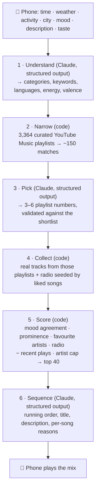

# Melodi AI

**A context-aware playlist planner for the Melo app.** It turns a listener's moment (time of day, weather, whether they're driving or walking, where they are, how they feel, or a sentence like *"long drive to Vizag at night"*) into a 25-song mix of real songs, each with a one-line reason.

Built with **Python · FastAPI · the Anthropic SDK (Claude, structured outputs) · ytmusicapi · Pydantic**.

> Part of [Melo](../README.md), a learning project. For experimentation and study only.

---

## The problem with "just ask an LLM for songs"

The obvious design is to ask an LLM *"give me rainy-night Telugu songs"* or to run its words through YouTube search. Both are unreliable. The LLM can invent songs, and search returns whatever matches the words, with nothing checking that a song actually *sounds* like a rainy night.

Melodi uses the LLM for what it's good at (**understanding context and making judgement calls between real options**) and takes the songs from **human-curated sources**.

## How it works



1. **Understand.** Claude reads the moment and returns a `MusicTarget`: which of YouTube Music's 39 mood and genre categories fit, title keywords (e.g. *Tollywood*), languages, and target **energy** and **valence**. Valence (sad ↔ happy) and arousal (calm ↔ energetic) are the two axes music-emotion research uses.
2. **Narrow.** YouTube Music's *Moods & genres* section holds ~3,400 editor-curated playlists, each labelled by category and shelf (e.g. *Sad › Bollywood sad*). Sending them all on every request would cost ~40K tokens, so code filters them to ~150 using the target's categories and keywords.
3. **Pick.** Claude chooses 3–6 playlists from that numbered shortlist. **Every number is checked in code**, so a hallucinated pick is simply dropped.
4. **Collect.** The chosen playlists' real tracks, plus YouTube radio seeded from songs the listener has liked *that also appear in today's picks* (fits both mood and taste).
5. **Score.** A transparent, deterministic ranking: songs several curated lists agree on score highest, then favourite artists and radio. Different uploads of the same song (lyric video, official video, audio) are merged first, keeping the official audio and crediting every playlist any version appeared in. Recently played songs are dropped, and each artist is capped at 3.
6. **Sequence.** Claude orders the best 40 into a smooth energy flow and writes the title, description and a short "why" for each song. Code again validates every number and tops up from the scores if needed.

**Design principles**
- **The LLM chooses, code verifies.** Claude only ever returns numbers from lists the code gave it, so it can't invent playlists or songs.
- **Structured outputs everywhere.** Each step returns a Pydantic model (`MusicTarget`, `PlaylistPicks`, `MixPlan`) through `client.beta.messages.parse(output_format=...)`, so there's no regex parsing of free text.
- **Deterministic where it can be.** Narrowing, collecting and scoring are plain code with unit tests. Results are reproducible, and cost and latency are predictable.
- **Cost and latency aware.** Three short calls at low effort instead of one huge prompt. Token usage and timing are returned with every response (`usage`).
- **Privacy.** The phone turns location into labels ("driving", "Hyderabad", "light rain, 24°C"). GPS coordinates never reach this server, and nothing is stored.
- **Resilient.** If a playlist fails to load, the mix still works. Server-side refusal fallbacks are enabled, and errors map to clear HTTP statuses.

## API

`POST /v1/plan`

```json
{
  "size": 25,
  "context": {
    "local_time": "2026-10-28T21:40:00+05:30",
    "daypart": "night",
    "weather": "light rain, 24°C",
    "activity": "driving",
    "city": "Hyderabad",
    "country_code": "IN",
    "mood": "calm",
    "description": "long drive, soft melodies",
    "taste": { "top_artists": ["Sid Sriram"], "liked_video_ids": [], "recent_video_ids": [] }
  }
}
```

The response has `title`, `description`, the `target`, the `sources` (curated playlists used), `tracks` (each with `why`) and `usage` (model, tokens, LLM calls, seconds). `GET /health` reports status and model.

## Run it locally

Requires [uv](https://docs.astral.sh/uv/) and an [Anthropic API key](https://console.anthropic.com/settings/keys).

```bash
cd melodi-ai
cp .env.example .env          # then paste your ANTHROPIC_API_KEY into .env
uv sync
uv run uvicorn app.main:app --host 0.0.0.0 --port 8787
```

Point the app at it: in the Melo root, `cp .env.example .env` and set `EXPO_PUBLIC_MELODI_URL=http://<your Mac's IP>:8787`, then rebuild the app.

## Tests

```bash
uv run pytest
```

These cover the deterministic core: target cleaning, catalogue narrowing, rejecting invented playlist numbers, scoring and artist caps, and assembling the final order.

## Code map

| File | Role |
|---|---|
| `app/main.py` | FastAPI app, optional `X-Melodi-Token` check, error → HTTP mapping |
| `app/planner.py` | The pipeline and the three prompts |
| `app/llm.py` | The only Claude call site: structured output, effort, fallbacks, usage accounting |
| `app/catalog.py` | Loads and caches (24 h, per country) YouTube Music's curated Moods & genres playlists |
| `app/candidates.py` | Collects real tracks and scores them |
| `app/models.py` | Request, response and structured-output schemas |

## Roadmap

- **Evals:** a scenario set ("rainy night, sad, Telugu", "gym, hype, English"…) scored by rules plus an LLM judge, run in CI.
- **Taste embeddings:** listening history in Supabase pgvector, for better taste matching.
- **🎬 Shot here:** songs from films shot in the listener's city, using Wikidata filming locations → soundtrack albums.
- **Audio features:** on-audio mood estimates (e.g. Essentia arousal/valence, CLAP text-to-audio similarity) to check that a song really sounds calm or energetic.
- **Tool-use agent:** expose catalogue search, candidate collection and scoring as separately defined tools so Claude can iterate when a mix looks weak.
