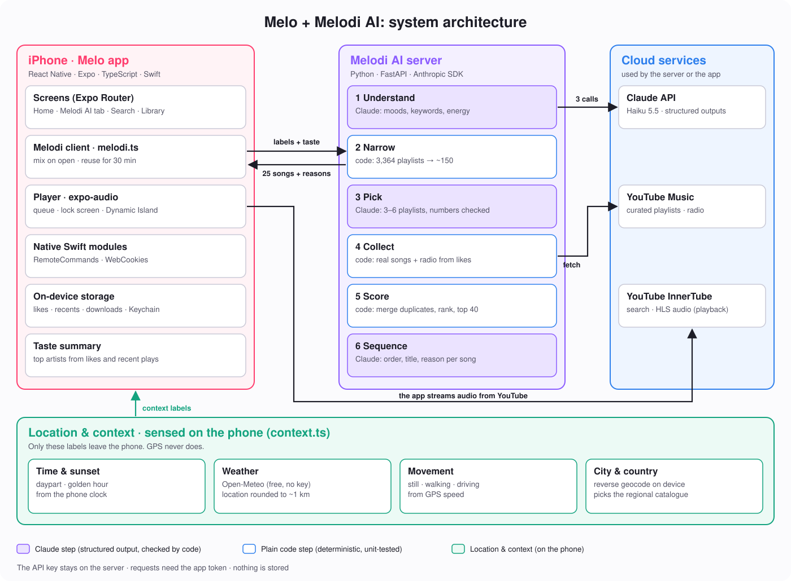

<h1 align="center">Melodi AI</h1>

<p align="center">
  
  
  
  
  
  
</p>

<p align="center"><b>An AI DJ that reads your moment and builds a mix of real songs, with a reason for every pick.</b></p>

Tell it nothing and it still works: it knows it's 9:40 pm, raining, you're driving through Hyderabad, and you mostly listen to Sid Sriram. It comes back with 25 songs that fit, each with a one-line reason, in about 14 seconds and for about a fifth of a cent.

> [!IMPORTANT]
> **A learning project, not a product.** I built Melodi AI to learn how to put an LLM into a real feature without letting it make things up: structured outputs, grounding the model in real data, measuring cost and latency, and testing everything around the model. It isn't affiliated with YouTube, Google or Anthropic. See the [disclaimer](#disclaimer).

<p align="center"></p>

---

## Contents

1. [What it produces](#what-it-produces)
2. [At a glance](#at-a-glance)
3. [How Melodi picks songs](#how-melodi-picks-songs)
4. [The three Claude calls](#the-three-claude-calls)
5. [What I built](#what-i-built)
6. [Design decisions and trade-offs](#design-decisions-and-trade-offs)
7. [Measured results](#measured-results)
8. [Testing](#testing)
9. [Security and privacy](#security-and-privacy)
10. [Limitations](#limitations)
11. [Run it](#run-it)
12. [Roadmap](#roadmap)

---

## What it produces

A real request: *Wednesday 9:40 pm · light rain, 24°C · driving · Hyderabad · mood "calm" · "long drive, soft melodies" · favourite artists Sid Sriram, M.M. Sreelekha, Anirudh.*

> **🌧️ Rain-Soft Roads Through Hyderabad Night**
> *A gentle, rain-washed sequence that eases you through Hyderabad's late-night streets with Sid Sriram and Anirudh at its heart.*
>
> 1. **Maate Vinadhuga** · Sid Sriram: *gentle voice opens softly for the rainy night drive*
> 2. **Nuvvunte Chaley** · Anirudh Ravichander: *understated melody settles the car into a calm rhythm*
> 3. **Chuttamalle** · Shilpa Rao: *soothing vocals keep the mood warm and unhurried*
> 4. **Chamkeela Angeelesi (Rainy Lofi)**: *lofi texture matches the light rain on the windscreen*
> 5. …20 songs in total, from *Tollywood Romance*, *Tollywood Essentials*, *Night Drive* and three more curated playlists
>
> Claude Haiku 5.5 · 3 LLM calls · 8,090 input tokens · **$0.0018** · 14 s

---

## At a glance

| | |
|---|---|
| **What it is** | A Python web service. A phone sends a few context labels, and it returns a mix. |
| **LLM** | Claude Haiku 5.5 (default). Claude Opus 5.5 and Sonnet 5.5 work through one setting, `MELODI_MODEL`. |
| **SDK** | Anthropic Python SDK 2.3 (`anthropic`), Messages API |
| **Claude features used** | Structured outputs into Pydantic models (`client.beta.messages.parse(output_format=...)`), `effort` control, server-side refusal fallbacks on models that support them |
| **LLM tool calling** | Not used, on purpose. Code drives the pipeline, and Claude makes three bounded decisions ([why](#why-not-an-agent-with-tool-calling)). |
| **Song source** | YouTube Music's editor-curated **Moods & genres** playlists (3,364 of them) and radio, read through `ytmusicapi` |
| **Backend** | FastAPI, Pydantic v2, uvicorn, managed with `uv` |
| **Client** | React Native / Expo ([`clients/react-native`](clients/react-native)), used by the [Melo](https://github.com/nithin261829/melo) iPhone app |
| **Cost / speed** | ~$0.002 and ~14 s per mix on Haiku. Opus 5.5 was ~$0.05 and ~20 s ([measured](#measured-results)). |
| **Tests** | 9 pytest unit tests covering everything that isn't the LLM |

---

## How Melodi picks songs

The idea in one sentence: **Claude decides *what kind* of music fits, and real, human-curated playlists supply *which* songs.** Claude never names a song.

Here is the real request above, step by step.

**Step 1 · Understand the moment** (Claude)
Claude reads the context and fills in a small form:

```json
{
  "summary": "Night drive in light rain, calm and soft",
  "categories": ["Bollywood & Indian", "Commute", "Chill", "Romance"],
  "keywords": ["Tollywood", "Telugu", "Soft melodies", "Night drive", "Rain"],
  "languages": ["Telugu", "Tamil", "Hindi"],
  "energy": 0.25,
  "valence": 0.5
}
```

Nobody told it "Telugu". It worked that out from the favourite artists. Energy runs from 0 (calm) to 1 (energetic), and valence from 0 (sad) to 1 (happy).

**Step 2 · Narrow the menu** (code)
YouTube Music has 3,364 curated mood and genre playlists. Code keeps the ones whose title matches a keyword (*Tollywood Romance*, *New Music Telugu*) or that sit in a chosen category (*Chill*, *Commute*), with keyword matches first. Result: a numbered shortlist of 150. This step is also what makes it cheap: sending all 3,364 would be about 40K tokens per request.

**Step 3 · Pick playlists** (Claude)
Claude picks 3–6 playlist numbers from the shortlist. Here it chose *Telugu*, *2026 Telugu*, *Tollywood Romance*, *Tollywood Romance Hitlist*, *Tollywood Essentials* and *Night Drive*. Code drops any number that wasn't on the list, so a hallucinated playlist can't get through.

**Step 4 · Collect real songs** (code)
Code loads every track in those six playlists. It also adds YouTube radio seeded from songs the listener has liked that also appear in today's picks, which brings in songs that fit both the mood and their taste. In this run: 274 uploads.

**Step 5 · Score and trim** (code)
Uploads of the same song (lyric video, official video, audio) are merged first, keeping the official audio. Then every song gets a transparent score:

| Signal | Points | Why |
|---|---|---|
| Appears in a chosen playlist | **+2.0 per playlist** | Several editors agreeing is the strongest signal of fit |
| Near the top of a playlist | up to **+0.5** | Editors put the standout songs first |
| By one of your favourite artists | **+1.5** | Taste |
| From radio seeded by a song you liked | **+1.0** | Taste and mood together |
| Played recently | **dropped** | Keeps mixes fresh |
| More than 3 songs by one artist | **dropped** | Variety |

The top 40 go forward. Re-scoring this request's six playlists after adding the duplicate merge gave no repeated songs, and 33 of the 40 were official audio.

**Step 6 · Sequence and explain** (Claude)
Claude orders 25 of the 40 (20 in this run) into a smooth energy curve: it eases in, avoids jarring jumps, and never puts the same artist twice in a row. It writes the title, the description and a short reason for each song. Code checks every number again and tops up from the scores if Claude returns too few.

---

## The three Claude calls

All three calls go through one function, [`app/llm.py`](app/llm.py) → `ask()`. Every answer comes back as a validated Pydantic object, so nothing is parsed out of free text.

| Call | Input | Output (Pydantic model) | Checked by code |
|---|---|---|---|
| **1. Understand** | The context labels + the 39 category names | `MusicTarget`: summary, categories, keywords, languages, energy, valence | Unknown categories removed; energy and valence clamped to 0–1 |
| **2. Pick** | Context + target + 150 numbered playlists | `PlaylistPicks`: a list of playlist numbers | Only numbers on the list are accepted; at most 6 |
| **3. Sequence** | Context + 40 numbered candidate songs | `MixPlan`: title, description, and an ordered list of `{number, why}` | Invalid or duplicate numbers dropped; topped up from scores |

```python
# app/llm.py (simplified)
response = client.beta.messages.parse(
    model=MODEL,                       # claude-haiku-5-5 by default
    max_tokens=16000,
    system=system,
    messages=[{"role": "user", "content": prompt}],
    output_format=schema,              # e.g. MusicTarget, a Pydantic model
    output_config={"effort": "low"},   # short judgement calls don't need deep thinking
    **fallback,                        # refusal fallbacks, only for models that support them
)
return response.parsed_output          # an instance of `schema`
```

Every response also returns `usage` (model, input and output tokens, number of LLM calls, seconds), so cost and latency are visible on every request.

---

## What I built

| Component | File | What it does |
|---|---|---|
| **HTTP API** | `app/main.py` | `POST /v1/plan` and `GET /health`; app-token check; maps failures to clear HTTP errors (401, 422, 503) |
| **Pipeline** | `app/planner.py` | Runs the six steps and holds the three prompts |
| **LLM gateway** | `app/llm.py` | The only place that calls Claude: structured output, effort, fallbacks, usage accounting |
| **Catalogue loader** | `app/catalog.py` | Reads all 39 Moods & genres pages concurrently, with my own parser (ytmusicapi's crashes on mixed pages), and caches per country for 24 h |
| **Candidate collector and scorer** | `app/candidates.py` | Loads playlists and radio in parallel, merges duplicate uploads, scores and trims |
| **Schemas** | `app/models.py` | Request, response and the three structured-output models |
| **Phone client** | `clients/react-native/` | Turns location into labels on the device (`context.ts`) and calls the API (`melodiClient.ts`) |
| **Tests** | `tests/test_pipeline.py` | 9 offline unit tests |

---

## Design decisions and trade-offs

The questions I'd expect in an interview, and my answers.

**Why not just ask the LLM for songs?**
It invents songs that don't exist, and it can't know what's on YouTube today. Plain search is no better: it matches words, not how a song sounds. Here, songs only ever come from real playlists, and Claude can only choose from numbered lists the code gives it.

**Why YouTube Music's curated playlists?**
They're picked by human editors and labelled by mood *and* language (for example *Sad › Bollywood sad*). That label is reliable signal I don't have to compute. Spotify's audio-features and recommendations APIs would have been the obvious alternative, but they've been closed to new apps since November 2024.

<a id="why-not-an-agent-with-tool-calling"></a>**Why not an agent with tool calling, or LangChain?**
I started out wanting LangChain. But the workflow here is fixed: every request goes through the same six steps. An agent deciding which tool to call adds round trips, cost and unpredictability without improving the result. So code orchestrates, and Claude makes three bounded decisions with typed outputs. That's simpler to test and to debug. A tool-use version is on the [roadmap](#roadmap), for the case where Claude should retry when a mix looks weak.

**Why three calls instead of one big prompt?**
Step 3 depends on step 2's shortlist, and step 6 depends on real songs that only exist after step 4. Splitting it also keeps each prompt small (~2–4K tokens) instead of putting 3,364 playlists into one request (~40K tokens).

**Why Haiku and not Opus?**
I measured both on the same request: similar mixes (12 of 20 songs identical), but Haiku was **~29× cheaper and 30% faster**. Each step is a short judgement over a small list, and the hard part, reliability, is handled by code and curated data. Switching models is one setting.

**Why is the scoring rule-based rather than learned?**
There's no training data yet, and transparent weights are easy to explain and to test. Learning them from likes and skips is the natural next step once there's feedback to learn from.

---

## Measured results

The same request on two models:

| | Claude Opus 5.5 | **Claude Haiku 5.5 (default)** |
|---|---|---|
| Input / output tokens | 8,200 / 980 | 8,090 / 1,986 |
| Cost per mix | ~$0.052 | **~$0.0018** |
| Time | 20 s | **14 s** |
| Mixes for $5 | ~95 | **~2,800** |
| Title | *Rain on the Hyderabad Highway* | *Rain-Soft Roads Through Hyderabad Night* |

Both mixes were calm Telugu and Tamil melodies centred on Sid Sriram and Anirudh, with 12 of 20 songs the same. Most of the time is spent in the three model calls; loading and scoring songs takes about a second.

---

## Testing

```bash
uv run pytest      # 9 passed
```

The tests cover everything around the model, where most real bugs live:

- Unknown categories are dropped, and energy and valence are clamped to 0–1
- Narrowing puts language matches first and leaves out unrelated playlists
- Invented and duplicate playlist numbers are rejected
- Agreement between playlists outranks a favourite artist, which outranks radio
- No more than 3 songs per artist
- Different uploads of the same song merge into one, keeping the official audio
- A song is skipped if *any* version of it was played recently
- The final order keeps Claude's valid picks and tops up when there are too few

Live runs are checked by hand: real songs, no duplicates, and the reasons match the songs. Automated LLM evals are next on the [roadmap](#roadmap).

---

## Security and privacy

- **No GPS reaches the server.** The phone turns location into labels ("Hyderabad", "driving", "light rain, 24°C"). Weather is looked up with a location rounded to about 1 km.
- **The API key stays on the server** in a git-ignored `.env`. It's never in the app or in the repo.
- **An app token** (`X-Melodi-Token`) means only your app can spend your API credit.
- **Nothing is stored.** Each request is handled and forgotten; the only cache is the public playlist catalogue.

---

## Limitations

Honest notes on what doesn't work yet:

- **Energy and valence don't affect the score.** Claude uses them when it picks playlists and orders the mix, but the code can't measure how calm a song actually sounds. Audio features would fix this.
- **Taste comes through strongly.** If your favourite artists are Telugu, most mixes will be Telugu even for "Focus" or "Hype", because keyword matches rank first.
- **Off-language songs can slip in** from mixed playlists (for example an English song from *Night Drive*).
- **It depends on an unofficial client.** `ytmusicapi` can break when YouTube changes its pages. I already had to work around one crash.
- **It runs on a local server,** so the phone needs to be on the same Wi-Fi. It isn't deployed.
- **There are no automated quality evals yet.** Quality is checked by hand.

---

## Run it

Requires [uv](https://docs.astral.sh/uv/) and an [Anthropic API key](https://console.anthropic.com/settings/keys). API credit is bought in the Anthropic Console; it's separate from a claude.ai plan.

```bash
git clone https://github.com/nithin261829/melodi-ai.git && cd melodi-ai
cp .env.example .env          # then put your ANTHROPIC_API_KEY in .env
uv sync
uv run uvicorn app.main:app --host 0.0.0.0 --port 8787
```

**API:** `POST /v1/plan`

```json
{
  "size": 25,
  "context": {
    "local_time": "2026-10-28T21:40:00+05:30",
    "daypart": "night",
    "weather": "light rain, 24°C",
    "activity": "driving",
    "city": "Hyderabad",
    "country_code": "IN",
    "mood": "calm",
    "description": "long drive, soft melodies",
    "taste": { "top_artists": ["Sid Sriram"], "liked_video_ids": [], "recent_video_ids": [] }
  }
}
```

The response has `title`, `description`, `target`, `sources` (the curated playlists used), `tracks` (each with `why`) and `usage`.

**Connecting a phone app** (phone and Mac on the same Wi-Fi):
1. Set `EXPO_PUBLIC_MELODI_URL=http://<Mac name>.local:8787` in the app. Find the name with `scutil --get LocalHostName`; a `.local` name survives IP changes.
2. Put the same random value in `MELODI_APP_TOKEN` (server) and `EXPO_PUBLIC_MELODI_TOKEN` (app). Generate one with `python3 -c "import secrets; print(secrets.token_urlsafe(24))"`.
3. Add `expo-location` with a `locationWhenInUsePermission` message and an `NSLocalNetworkUsageDescription` in `app.json`, then rebuild.
4. If the phone can't connect, allow `python3.12` in System Settings → Network → Firewall → Options.

---

## Roadmap

- **Evals:** a set of scenarios ("rainy night, sad, Telugu", "gym, hype, English") scored by rules plus an LLM judge, run in CI.
- **Audio features:** measure how calm or energetic a song really sounds (Essentia arousal/valence, CLAP text-to-audio), so energy can count in the score.
- **Tool-use agent:** expose catalogue search, collection and scoring as tools so Claude can retry when a mix looks weak.
- **Learned scoring:** tune the weights from likes and skips, with taste embeddings in pgvector.
- **🎬 Shot here:** songs from films shot in your city, using Wikidata filming locations and soundtrack albums.
- **Deploy** so it works away from home Wi-Fi.

---

## Disclaimer

**This project exists only for experimentation, learning and study.**
- Melodi AI reads public YouTube Music catalogue pages through [ytmusicapi](https://github.com/sigma67/ytmusicapi). It isn't affiliated with, endorsed by or connected to YouTube, Google or Anthropic. "YouTube Music" is a trademark of Google LLC.
- Automated access to YouTube may conflict with YouTube's Terms of Service. Use it for learning, not for commercial purposes or to redistribute content.
- All music, artwork and metadata belong to their respective owners.
- The code is provided as-is, with no warranty.

## License

[MIT](LICENSE), for the code in this repository only. It grants no rights to any music, artwork or other content.
